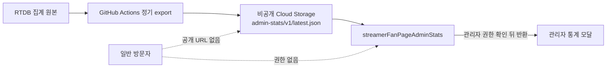

# 관리자 통계 정적 스냅샷 설계 및 작업 지시

## 목적

팬페이지와 고점체크의 관리자 통계는 현재 `streamerFanPageAdminStats` 호출마다 RTDB의 팬페이지 조회 집계, 고점체크 사용자별 사용량, 대기열을 읽어 최근 30일 데이터를 다시 합산한다. 관리자가 통계 모달을 열거나 새로고침할 때마다 같은 집계를 반복하므로, 이를 주기적으로 생성한 비공개 정적 스냅샷으로 전환한다.

이 설계의 목표는 다음과 같다.

- 관리자 화면을 열 때의 RTDB 읽기와 함수 실행 시간을 작고 예측 가능하게 만든다.
- 팬페이지 조회 통계와 고점체크 사용량을 같은 시각 기준으로 보여 준다.
- UID, UID 해시, 방문자 표식, 개별 요청·작업 레코드가 정적 산출물이나 브라우저에 노출되지 않게 한다.
- 스냅샷 생성 실패 시 마지막 정상 스냅샷을 유지하고, 비용 절감을 위해 관리자 화면에서 원본 전체 재집계를 자동 실행하지 않는다.

## 범위

정적 스냅샷에 포함할 관리자용 집계는 아래와 같다.

| 영역 | 포함 항목 |
| --- | --- |
| 팬페이지 | 인증 스트리머 수, 누적·최근 7일·최근 30일 조회, 스트리머별 누적/30일 조회와 일별 조회·일별 순방문 |
| 고점체크 요청 | 오늘·7일·30일 요청 수, 액션별 요청, 등급별 요청, 일별 요청 추이, 상위 선택 스트리머 |
| 고점체크 운영 | 대기열 등록·완료·실패·취소·캐시 적중, 등급별 현재 대기 수, 평균 대기 시간 |
| 고점체크 데이터·비용 | RTDB·SOOP·callable payload, 함수 호출·실행 시간, 정적 생성 사용량, 기간별 예상 비용 |

구독 신청, 다마고치 신청, 디자인 문의처럼 관리자가 처리해야 하는 개별 대기 항목은 집계가 아니다. 해당 목록은 기존 관리자 전용 callable을 유지하고 정적 스냅샷에 넣지 않는다.

## 보안 경계

관리자 통계 JSON을 GitHub Pages의 `static-data/`에 배포하면 누구나 URL로 내려받을 수 있다. 이 파일에는 사용량과 운영 상태가 포함되므로 공개 정적 파일로 만들지 않는다.



- 스냅샷 버킷은 Uniform bucket-level access를 사용하고 public access prevention을 켠다.
- `fanpage-static-exporter` 서비스 계정에는 이 버킷의 `admin-stats/` 객체만 쓰기·교체할 권한을 준다.
- `streamerFanPageBootstrap` 등이 사용하는 런타임 서비스 계정에는 해당 객체의 읽기 권한만 준다.
- 브라우저는 Cloud Storage URL, signed URL, Firebase Storage 다운로드 URL을 직접 받지 않는다. `streamerFanPageAdminStats`가 `adminCenter/adminUids/{uid}`를 재검증한 뒤 내용만 반환한다.
- JSON에는 UID, UID 해시, IP, 방문자 해시, 구독 신청 정보, 개별 작업 ID, 원본 검색어를 포함하지 않는다.

## 목표 데이터 구조

Cloud Storage 객체: `gs://<private-admin-stats-bucket>/admin-stats/v1/latest.json`

스냅샷은 기존 `streamerFanPageAdminStats` 응답과 호환되는 형태를 유지한다. 클라이언트 렌더링을 바꾸지 않고 로딩 경로만 바꿀 수 있다.

```json
{
  "schemaVersion": 1,
  "generatedAt": 1790000000000,
  "sourceWindow": { "days": 30, "timezone": "Asia/Seoul" },
  "totals": {},
  "viewerStatsUsage": {},
  "streamers": []
}
```

`generatedAt`과 `schemaVersion`은 필수다. exporter는 업로드 전에 전체 schema·날짜·숫자·민감 필드를 검증한다. Cloud Storage generation precondition을 사용해 기존 객체를 조건부로 교체하므로 업로드 실패나 동시 실행 충돌은 마지막 정상 파일을 덮어쓰지 않는다.

## 집계 원본과 비용 절감 방식

정적 파일만 도입하고 exporter가 매번 `streamerFanPageViewerStatsLimits` 전체를 읽으면, 관리자 화면 비용은 줄어도 정기 export의 읽기 비용은 남는다. 최종 구조에서는 관리자 전용 보고용 projection을 유지한다.

| 원본 | 보고 projection | 쓰기 시점 |
| --- | --- | --- |
| `streamerFanPageStats/{soopId}` | `streamerFanPageAdminMetrics/v1/fanpage/statsLive/{soopId}` | `recordFanPageView`가 조회를 확정한 뒤 같은 날짜의 조회·순방문·누적 카운터 갱신 |
| `streamerFanPageViewerStatsLimits/{uidHash}` | `streamerFanPageAdminMetrics/v1/viewerStats/dailyLive/{YYYY-MM-DD}` | 고점체크 액션·등급·payload·비용·스트리머 카운터를 원본에 기록하는 시점에 익명화된 합계 갱신 |
| `streamerFanPageViewerStatsQueue` | `streamerFanPageAdminMetrics/v1/viewerStats/queueLive/{tier}` | 대기열 등록·제거 시 등급별 현재 수 갱신. 완료·실패·취소·캐시 적중은 일별 usage projection에 기록 |

projection에는 관리자 화면이 필요로 하는 합계만 기록한다. 사용자별 rate limit 원본과 작업 레코드는 그대로 서버 전용으로 유지하며 projection으로 대체하지 않는다.

현재 구현은 아래 경로를 사용한다. `baseline`은 1회 초기화된 기존 데이터의 집계이고, `live`는 초기화 뒤 writer가 기록한 변화량이다. exporter는 두 값을 합쳐 기존 callable 응답 schema를 만든다.

| projection | 경로 |
| --- | --- |
| 인증 스트리머 목록 | `streamerFanPageAdminMetrics/v1/fanpage/rosterBaseline` + `rosterLive` |
| 팬페이지 조회 | `streamerFanPageAdminMetrics/v1/fanpage/statsBaseline/{soopId}` + `statsLive/{soopId}` |
| 고점체크 일별 사용량 | `streamerFanPageAdminMetrics/v1/viewerStats/dailyBaseline/{date}` + `dailyLive/{date}` |
| 현재 대기 수 | `streamerFanPageAdminMetrics/v1/viewerStats/queueBaseline` + `queueLive` |
| 스트리머 표시명 | `streamerFanPageAdminMetrics/v1/fanpage/namesBaseline` + `namesLive` |

`functions/backfill-admin-stats-projection.js`는 초기 전환·복구 때만 기존 원본을 읽고, 현재 `live` 합계를 빼서 `baseline`을 만든 뒤 30일 snapshot 결과를 원본 집계와 비교한다. 검색 선택 순위의 닉네임은 표시 정보이므로 검증은 SOOP ID와 횟수 기준으로 비교한다. 비교가 다르면 실행을 실패 처리하고 관리자 callable은 아직 전환하지 않는다. 이후 정기 exporter는 위 projection 경로만 읽는다. `streamerVerifications` 변경은 `streamerFanPageAdminStatsRosterProjection`이 UID를 제외한 스트리머 표시 정보로 반영하며, 고점체크 VOD 조회 응답에서 서버가 확인한 닉네임은 `namesLive`에 기록하고 90일 뒤 정리한다.

조회·사용량 누적값은 다중 경로 업데이트에 `ServerValue.increment()`를 쓰고, 현재 대기 수는 RTDB transaction으로 음수가 되지 않게 유지한다. 스트리머 목록은 `streamerVerifications/{verificationKey}`의 재시도 가능한 writer trigger가 UID를 제외한 공개 필드만 live projection에 upsert/tombstone한다. 원본 writer와 projection writer는 별도 기록이므로 운영 중 projection 누락 여부를 주기적으로 확인하고, 대조·복구 때만 원본 전체 집계를 읽는다. 대조 작업이 평상시 관리자 화면의 대체 경로가 되어서는 안 된다.

## 실행 흐름

1. **Projection 추가 및 이중 검증**
   - 기존 집계 writer에 projection 갱신을 추가한다.
   - 최근 30일 원본과 projection을 비교하는 검증 스크립트를 만든다.
   - 일치율이 확인되기 전에는 기존 `streamerFanPageAdminStats`의 원본 집계를 유지한다.

2. **비공개 exporter 추가**
   - `functions/export-admin-stats.js`에서 projection만 읽어 `latest.json`을 만든다.
   - VOD exporter와 달리 결과물을 `static-data/`에 쓰거나 Pages artifact에 복사하지 않는다.
   - schema 검증, 숫자 범위 검증, 30일 날짜 배열 완전성 검증, UID 계열 키 부재 검증을 통과한 경우에만 generation precondition으로 최신 파일을 교체한다.

3. **정기 실행 구성**
   - GitHub Actions의 별도 workflow `admin-stats-snapshot.yml`을 만든다. Pages 배포 workflow와 결합하지 않는다.
   - 기본 주기는 매시 10분(UTC)이다. 실행 중복을 막기 위해 concurrency group을 하나로 고정한다.
   - 수동 실행도 제공하되, 관리자가 화면에서 누르는 새로고침은 export를 실행하지 않고 기존 스냅샷만 다시 읽는다.
   - export가 실패하면 마지막 정상 객체를 보존한다. 실패 알림은 GitHub Actions와 Cloud Logging에서 확인할 수 있게 남긴다.

4. **관리자 callable 전환**
   - `streamerFanPageAdminStats`는 먼저 관리자 권한을 확인하고 private object를 읽어 반환한다.
   - 파일이 없거나 schema가 맞지 않으면 사용자별·방문자별 원본을 즉시 전체 재집계하지 않는다. 관리자 화면에는 마지막 생성 시각과 실패 상태를 보여 준다.
   - 운영자만 사용할 수 있는 별도 복구 action에서만 원본 재집계 또는 export 재실행을 허용한다.

5. **클라이언트 표시**
   - `app.js`는 기존 응답 필드를 유지해 렌더링한다.
   - `generatedAt`이 70분을 넘기면 `집계 갱신 지연` 상태를 표시한다. 통계를 0으로 바꾸거나 이전 데이터를 숨기지 않는다.
   - 새로고침 버튼의 문구는 `스냅샷 다시 불러오기`로 바꾼다. 이 버튼은 비용이 큰 재집계를 수행하지 않는다.

## 지시문

이후 팬페이지 또는 고점체크의 관리자 집계를 추가·수정할 때 아래 규칙을 지킨다.

1. 관리자 화면에 새 집계 값을 추가하면, 원본 경로·projection 필드·스냅샷 schema·클라이언트 렌더링을 한 작업에서 함께 정의한다.
2. 개인 식별자, UID 해시, IP, 원본 검색어, 개별 신청·작업 데이터는 projection과 스냅샷에 넣지 않는다.
3. 관리자용 JSON은 Pages artifact, 공개 저장소 추적 파일, 공개 CDN 경로에 넣지 않는다. private Cloud Storage와 관리자 권한 callable 경로만 사용한다.
4. 페이지 로드나 관리자 모달 열기, 새로고침 버튼으로 RTDB 전체 집계를 실행하지 않는다. 화면은 가장 최근의 유효한 스냅샷을 읽는다.
5. exporter는 원본 사용자별 사용량 전체가 아니라 관리자 보고 projection을 읽는다. 원본 전체 재집계는 대조·복구 작업으로 한정한다.
6. 스냅샷 교체 전 schema·날짜 범위·숫자·민감 키 검증을 수행한다. 검증 실패 시 마지막 정상 스냅샷을 유지한다.
7. 정기 export가 만든 RTDB 읽기·함수 실행·Cloud Storage 전송량은 고점체크 데이터 사용량과 별도로 계측해 절감 효과를 비교한다.
8. 배포 전에는 exporter 단위 테스트, schema 검증 실패 테스트, 비관리자 callable 거부, 관리자 스냅샷 표시, stale 스냅샷 표시, export 실패 후 이전 파일 유지 시나리오를 확인한다.
9. 서버 변경은 `fanpage` codebase의 변경 함수만 명시해 배포한다. 전체 Functions 배포는 금지한다.

## 완료 기준

- 관리자 통계 모달을 열어도 팬페이지 조회 원본·고점체크 사용자별 limit 원본을 읽지 않는다.
- 스냅샷 생성 전·후의 30일 팬페이지 조회와 고점체크 집계가 원본 대조값과 일치한다.
- 비관리자와 로그아웃 사용자는 스냅샷 내용 및 Cloud Storage 객체 URL을 얻을 수 없다.
- Pages 배포 artifact에 `admin-stats` JSON이 포함되지 않는다.
- export 실패 때 기존 통계가 유지되고 화면에 생성 시각 및 지연 상태가 표시된다.
